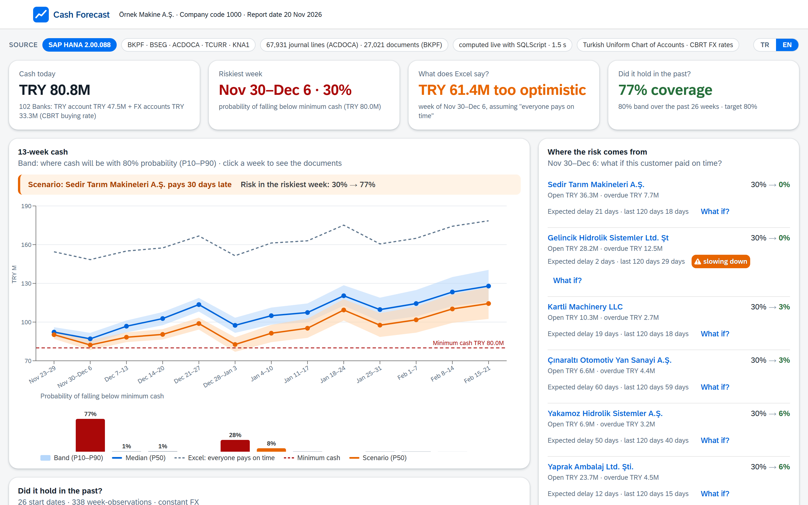
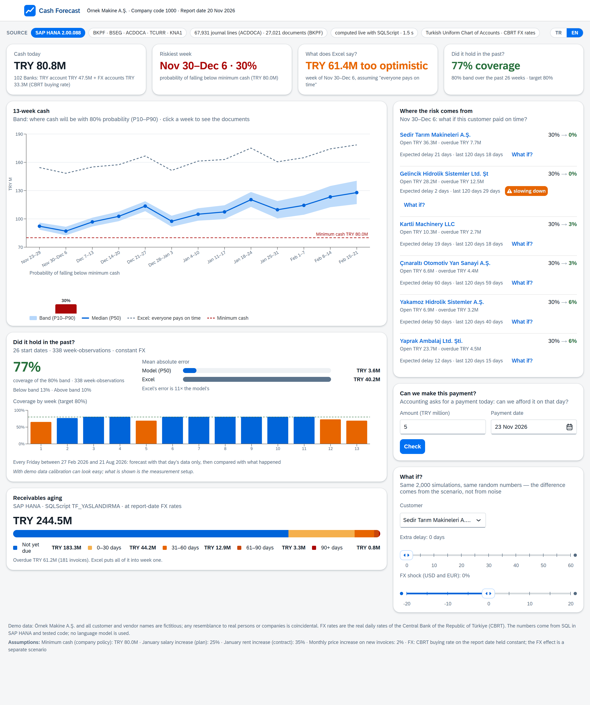
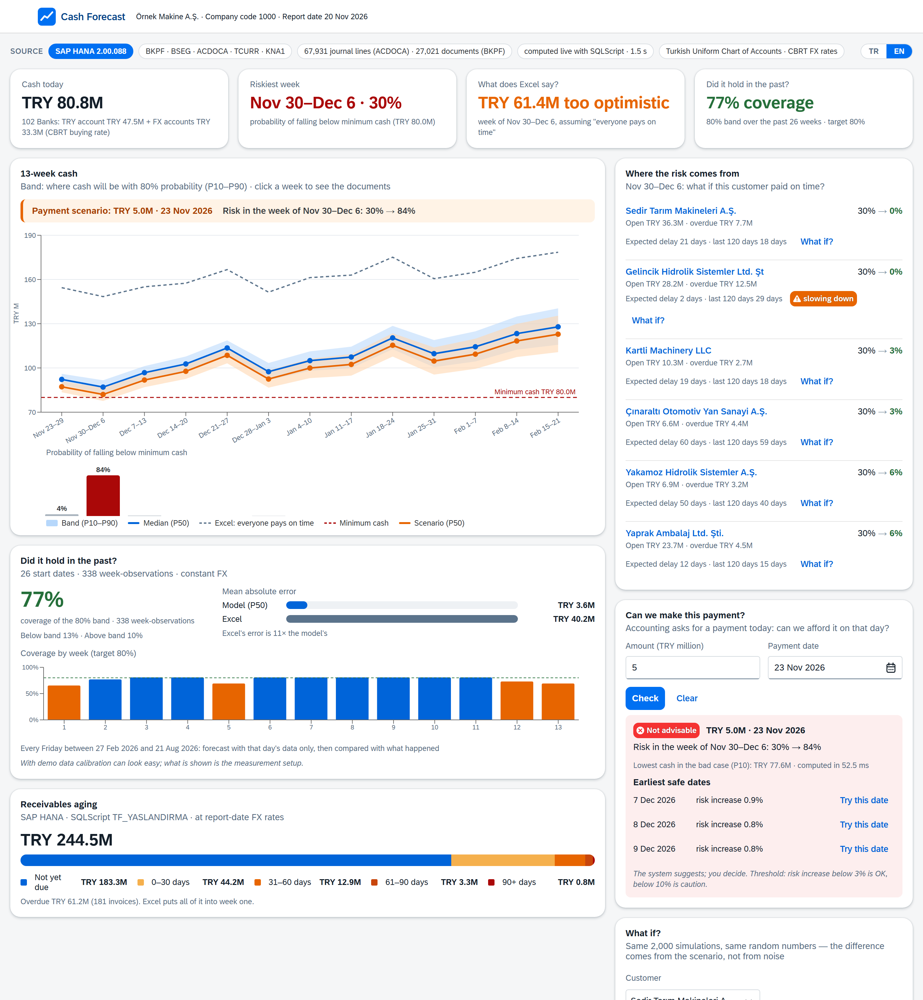
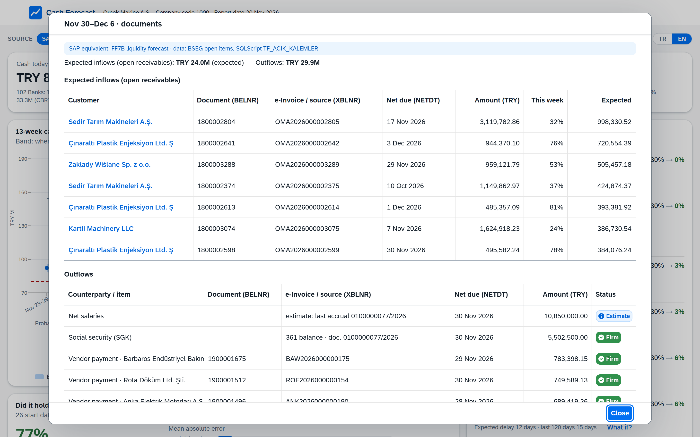
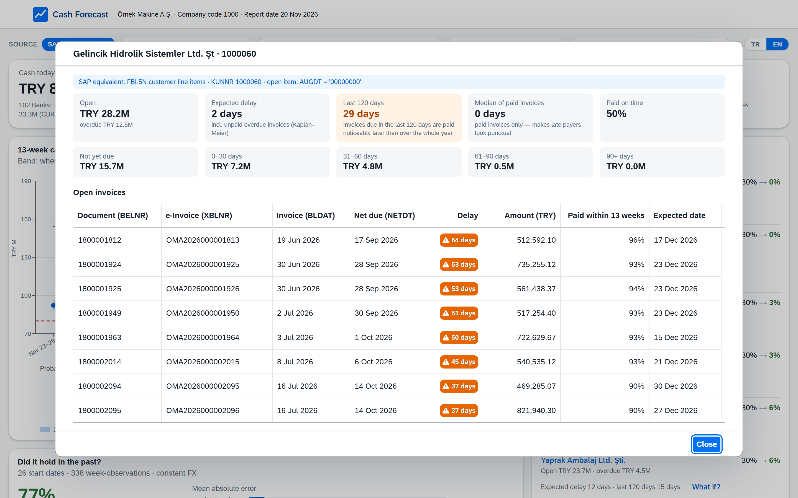
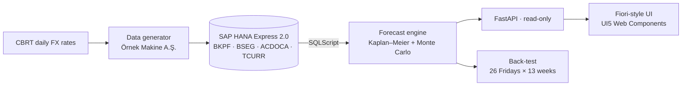

# Cash Forecast · 13 weeks on SAP HANA, with measured confidence

> Excel says "everyone pays on time" and draws a single line.
> This app looks at each customer's **actual payment behaviour**, draws a band whose past
> accuracy is **measured**, and tells you **which customer** the risk comes from.

▶️ **Demo video:** [18 seconds](video/hazine-tanitim-en.mp4)

**First project of the SAP HANA Finance Series:** Treasury → Tax → Accounting → Finance.
All of them use SAP's table structure, the Turkish Uniform Chart of Accounts and the real daily FX rates
of the Central Bank of the Republic of Türkiye (CBRT).

---

## The problem

Every week, a treasury analyst builds a 13-week cash forecast. Usually it lives in Excel and assumes
*everyone pays on time, and anything overdue arrives this week.*
The forecast comes out optimistic, and the gap only shows when the money does not arrive.

## In 60 seconds

1. **A band, not a line.** Where cash will be with 80% probability (P10–P90), next to Excel's line.
2. **The riskiest week.** *Nov 30 – Dec 6: a 30% probability of falling below minimum cash.* For that week Excel says TRY 148M; the median forecast says TRY 87M.
3. **Where the risk comes from.** *"If Sedir Tarım paid on time, this risk would drop from 30% to 0%."* The model flags customers who have started to pay later, on its own.
4. **What if?** *"If Sedir pays 30 days late, the risk jumps to 77%."* Same 2,000 simulations, same random numbers; results in milliseconds.
5. **Can we make this payment?** Accounting asks to pay TRY 5M today: *"Not advisable: risk in the week of Nov 30 rises from 30% to 84%. Earliest safe date: Dec 7."* The system suggests; a person decides.
6. **Every number drills down to a document.** Click a week to see the SAP document number (BELNR), e-invoice number (XBLNR), due date and probability. The window also names its SAP equivalent: the FF7B liquidity forecast.
7. **Customer card.** Open invoices, expected payment dates, aging. SAP equivalent: FBL5N.

| Overview | Payment check | A week's documents | Customer card |
|---|---|---|---|
|  |  |  |  |

The interface is bilingual (Turkish / English).

## The numbers

All measured. The command and output behind each one are in [EVIDENCE.md](EVIDENCE.md).

| Measurement | Result |
|---|---|
| Back-test | 26 Fridays × 13 weeks = 338 observations; each start date uses only the data known on that day |
| Coverage of the 80% band | **76.9%** (target 80% · 13.0% fell below · 10.1% fell above) |
| Mean absolute error | **Model TRY 3.6M · Excel TRY 40.2M** (Excel's error is 11× larger) |
| Excel's bias | **TRY 40.2M too optimistic** on average |
| Blind test | While generating the data, 4 customers were secretly slowed down. **All 7** of the top-7 "risk sources" are customers that the hidden profile marks as late payers or as slowing down. The model never saw those labels. |
| Speed | Setup 0.9 s (HANA queries + 2,000 simulations) · scenario ~10 ms · payment check with a 20-day scan ~50 ms |
| Data | 27,021 documents · 67,931 journal lines · 80 customers · 40 vendors · 28 months · trial balance 0.00 |
| Tests | 33 tests. When two critical fixes were reverted, the matching tests turned red. |

> **Note:** All data in this project is **demo data** (sample company: Örnek Makine A.Ş.).
> On demo data, calibration can look easy; what is shown here is the measurement setup.
> It must be re-measured on real data.

## Faithful to SAP

- **Same tables and field names as SAP:** `T001`, `SKAT`, `KNA1`/`KNB1`, `LFA1`/`LFB1`, `T052`/`T052U`, `TCURR`, `BKPF`, `BSEG`, `ACDOCA`.
- Dates are `NVARCHAR(8)` `'YYYYMMDD'`. Open item: `AUGDT = '00000000'`.
- Net due date the SAP way: `ZFBDT + ZBD1T`.
- `BSEG` holds positive amounts plus `SHKZG` (S/H); `ACDOCA` holds signed amounts. Both balance to zero per document.
- Posting keys `01/15` (customer), `31/25` (vendor), `40/50` (G/L). Document types `DR` `DZ` `KR` `KZ` `SA`.
- **Inverted-date FX table:** `GDATU = 99999999 − YYYYMMDD`. `B` = CBRT buying rate, `G` = selling rate; valid from the day after publication.
- **Turkish Uniform Chart of Accounts** (`KTOPL = TDHP`), 10-digit accounts: 102 Banks, 120 Receivables, 191 Deductible VAT, 320 Payables, 335, 360, 361, 391, 600/601, 646/656, 7xx.
- Turkish e-invoice numbers: `OMA2026000002805` (3 letters + year + 9 digits).
- FX differences on collection are posted automatically to 646 / 656 ([example](sample-data/BSEG.csv)).

## What happens in HANA

- **SQLScript table functions** ([`hana/schema.sql`](hana/schema.sql)):
  - `TF_ACIK_KALEMLER(date)`: open items as of that evening. It never sees the future, which is what the back-test relies on.
  - `TF_ODEME_GECMISI(date, days)`: payment history, including unpaid overdue invoices (censored observations).
  - `TF_YASLANDIRMA`, `TF_BANKA_BAKIYELERI`, `TF_KUR`. The last one finds the valuation rate with the inverted-date trick.
  - The identifiers are Turkish: *açık kalemler* = open items, *ödeme geçmişi* = payment history, *yaşlandırma* = aging, *banka bakiyeleri* = bank balances, *kur* = FX rate. The full glossary is at the top of the schema file.
- Customer delay percentiles come from `PERCENTILE_CONT … OVER (PARTITION BY …)`.
- **The API connects with a read-only user.** A write attempt is rejected by HANA with `insufficient privilege`, and a test checks this.

## How it works

- **Payment behaviour:** a weighted Kaplan–Meier estimator per customer. An overdue but unpaid invoice carries the information "at least this late". Looking only at paid invoices makes late payers look punctual.
- Recent observations weigh more (120-day half-life). Customers with few observations are pulled toward the pooled distribution.
- Overdue items are sampled conditional on "not paid so far".
- The company's own payment behaviour is learned from history too: how far payments drift from the payment-run policy.
- Accrued VAT, withholding tax and social security are **firm** amounts (HANA balances). Later months are **estimates**, and the screen shows where each estimate comes from.
- **Code computes the money.** No language model is used.

## Caught along the way

Each of these is locked in by a test: reverting the fix turns the test red.

- **Calendar:** comparing the holiday list with the days the central bank published no rates showed that 30 Aug 2024 and six half-day holiday eves were missing.
- **Social security due date:** January social security, accrued on 29 January, was falling due on 31 January. Correct: the end of the following month.
- **Long tail:** an invoice 64 days overdue was predicted to be paid "7 months later". Unknown delay is now spread along the conditional shape of the pooled distribution.
- **On-screen median:** a median computed from paid invoices only showed a slowing customer as "0 days". The screen now shows the model's own measure (Kaplan–Meier).

## Limits

- All data is demo data; calibration must be re-measured on real data.
- The 80% band covered 76.9%, so it is slightly too narrow. The weakest point is week 1 (65%).
- FX rates are not forecast; FX impact is a separate scenario.
- One company code; no cheques or promissory notes.
- Tax calendar assumption: VAT and withholding tax on the 26th of the following month, social security at the end of the following month. These must follow official announcements.

## Connecting to a real SAP system

This prototype is not connected to a live SAP system. Connecting it takes three steps. The forecast
engine and the UI stay the same; only the data layer changes.

1. **Data access** (one of these, depending on the company):
   - **S/4HANA interfaces:** read open items, bank balances and FX rates through SAP's published OData APIs or CDS views.
   - **Replication:** copy the relevant tables to SAP Datasphere or SAP HANA Cloud. The SQLScript functions here run there unchanged.
   - **Direct HANA read:** only if the license allows it, and with a read-only user. Most runtime licenses do not.
2. **Company-specific mapping:**
   - Chart-of-accounts equivalents (102, 120, 320, 360, 361 …)
   - Multiple company codes
   - Partial payments and residual items
   - Cheques and promissory notes (special G/L indicators)
   - Cash discount terms (`ZBD1T` / `ZBD2T` / `ZBD3T`)
3. **Re-measurement:** re-run the calibration on real data, and set the minimum cash and decision thresholds to company policy.

A pilot takes roughly a few weeks; the exact time depends on the company's SAP setup and the access route.

## Tech

SAP HANA Express 2.0 SPS 08 (Docker) · SQLScript · `hdbcli` · Python 3.12 · NumPy · FastAPI ·
React 19 · UI5 Web Components 2.29 (SAP Fiori Horizon) · Recharts · pytest

## What is in this repository

- This README and the screenshots in [`images/`](images/). A script takes the screenshots from the running app; nothing is edited by hand.
- The HANA schema and SQLScript functions: [`hana/schema.sql`](hana/schema.sql).
- Small sample data: [`sample-data/`](sample-data/). It holds two invoices and their collections: a domestic sale with VAT and an export sale with an FX difference. The texts are Turkish, as in a Turkish company's SAP system (language key `T`): *Satış faturası* = sales invoice, *İhracat faturası (KDV istisna)* = export invoice (VAT-exempt), *Hesaplanan KDV* = output VAT, *Tahsilat* = collection, *Kur farkı* = FX difference, *gün net* = days net.
- The commands and outputs of every measurement: [`EVIDENCE.md`](EVIDENCE.md).
- Demo video: [`video/`](video/).
- The engine's source code is not in this repository.

## Data and trademarks

All data is demo data. Örnek Makine A.Ş. and all customer and vendor names are fictitious; any
resemblance to real persons or companies is coincidental. FX rates are the real daily rates of the
Central Bank of the Republic of Türkiye. SAP, SAP HANA, SAP S/4HANA and SAP Fiori are trademarks of
SAP SE. This project is not affiliated with SAP SE.

---

**Author:** Mehmet Işık · [mehmetisik.dev](https://mehmetisik.dev) · [GitHub](https://github.com/mmehmetisik)
